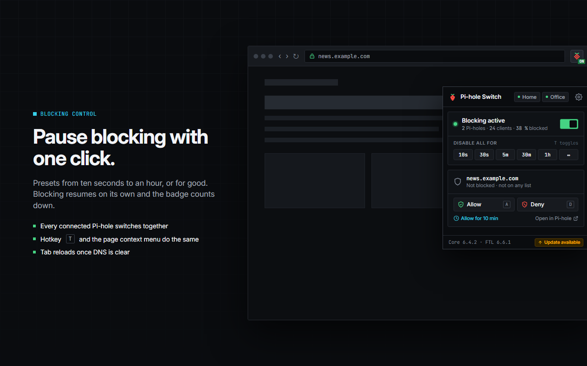

# PiHole Browser Extension


[](https://chromewebstore.google.com/detail/ngoafjpapneaopfkpboebcahajopcifi)
[](https://addons.mozilla.org/firefox/addon/pihole-browser-extension/)
[](https://chromewebstore.google.com/detail/ngoafjpapneaopfkpboebcahajopcifi)
[](https://addons.mozilla.org/firefox/addon/pihole-browser-extension/)
[](https://github.com/badsgahhl/pihole-browser-extension/actions/workflows/ci.yml)


**Pi-hole Switch** controls one or more [Pi-hole](https://pi-hole.net) v6 instances from the browser toolbar.
Pause blocking for a while, allow or deny the site you are on, and see at a glance what every Pi-hole is doing.



## Features

- **One switch for all your Pi-holes.** Pause for 10 s, 30 s, 5 min, 30 min, 1 h, until you enable it again, or any
  duration you type. The popup counts down and the toolbar badge shows the state.
- **The site you are on.** The popup tells you whether the current domain is blocked and by which list, allowed, or
  untouched. Allow or deny it with one click, or allow it for 10 minutes and let the extension remove the entry again.
- **Several Pi-holes.** Up to eight, for example a primary and a secondary DNS. Every switch, allow and deny goes to
  all of them at once; the chips in the popup header show the state of each one.
- **Hotkeys and context menu.** Toggle blocking, allow or deny the current domain and open the settings from
  keyboard shortcuts or the page's right-click menu. Inside the popup single keys do the same.
- **Toolbar badge.** `ON`, `OFF`, the remaining pause time, the blocked percentage of the day, or nothing at all.
- **Dark and light**, following the browser. English, Deutsch and Português (Brasil).
- **Yours only.** The extension talks to the addresses you enter and to nothing else. See [PRIVACY.md](PRIVACY.md).

This extension is a switch and stays one. For statistics, the query log and list management in the browser, see
[Pi-hole In One](https://github.com/creeperkatze/pihole-in-one).

## Requirements

- Pi-hole **v6** or newer. The extension uses the v6 REST API. For Pi-hole v5 stay on extension version 4.x.
- Chrome 103+, Edge, or Firefox 140+.

## Install

- Chrome and Edge: [Chrome Web Store](https://chromewebstore.google.com/detail/ngoafjpapneaopfkpboebcahajopcifi)
- Firefox: [Firefox Add-ons](https://addons.mozilla.org/firefox/addon/pihole-browser-extension/)

## Setup

1. Click the raspberry in the toolbar and choose **Add your Pi-hole**, or open the settings.
2. Enter a name, the address of the admin interface (for example `http://pi.hole` or `http://192.168.1.2:8080`;
   `/admin` is optional, reverse proxy paths work) and the password.
   An **app password** from Pi-hole › Settings › Web interface / API is the better choice: it is independent of the
   admin password and works when two-factor authentication is on. Leave the password empty if your Pi-hole has none.
3. Save. The browser asks once whether the extension may access that address. The extension tests the login and
   shows the Pi-hole's versions.

The extension requests access per address instead of to every website, so the prompt appears once per Pi-hole and
again after you change its address.

## The popup

| Key     | Action                                                    |
| ------- | --------------------------------------------------------- |
| `T`     | Toggle blocking                                           |
| `1`–`6` | Pause for 10 s, 30 s, 5 min, 30 min, 1 h, or indefinitely |
| `A`     | Allow the current site                                    |
| `D`     | Deny the current site                                     |
| `Esc`   | Close                                                     |

The browser-wide shortcuts (toggle, allow, deny, settings) are listed in the settings under **Shortcuts**, where you
can also change them. Firefox manages them in `about:addons` under _Manage Extension Shortcuts_.

## Several Pi-holes

Pi-hole Switch treats all configured Pi-holes as one. A pause pauses all of them, an allow entry lands on all of them.
That is what you want when two Pi-holes serve the same network as primary and secondary DNS. The popup header shows a
chip per Pi-hole with its state; if one is unreachable the popup says so and keeps working with the others.

## Troubleshooting

**Access needed.** The browser has not granted access to that address yet. Open the settings and click
**Grant access** next to the Pi-hole. After an update from version 4 this is expected once, because the extension no
longer asks for access to all websites.

**Unauthorized · check the password.** The password is wrong, or the Pi-hole uses two-factor authentication. Create
an app password in Pi-hole › Settings › Web interface / API and use that.

**No free API session.** Pi-hole limits the number of concurrent API sessions. The extension keeps exactly one
session per Pi-hole, reuses it across browser restarts and logs out when you remove or change the Pi-hole. Other
clients (the admin page, scripts, a second browser) take seats of their own. Close sessions you do not need under
Pi-hole › Settings › Web interface / API, or raise the limit there.

**Unreachable.** Check address and port, and that the admin interface opens in a normal tab. For `https://` with a
self-signed certificate, open the admin page once in the browser and accept the certificate.

**The site shows "Not blocked" although it is.** The lookup is exact. A list entry for `example.com` does not match
`cdn.example.com`; open the domain in Pi-hole from the popup to see the full picture.

**Debug information** for a bug report is in the settings under **About**.

## Development

Node 24 and pnpm 12.

```bash
pnpm install          # also prepares WXT types and installs the git hooks
pnpm dev              # Chrome with live reload
pnpm dev:firefox
pnpm test             # vitest
pnpm lint:check       # oxlint + eslint-plugin-vue
pnpm type-check
pnpm format
pnpm build            # .output/chrome-mv3
pnpm build:firefox    # .output/firefox-mv3
pnpm zip              # store zips, plus the sources zip for AMO with zip:firefox
```

Stack: [WXT](https://wxt.dev) (Manifest V3 for Chrome, Edge and Firefox), Vue 3, Tailwind 4, shadcn-vue, reka-ui,
Vitest. The Pi-hole API client in `src/lib/api/pihole` is generated from the FTL OpenAPI specification vendored in
`api-spec/`; `pnpm generate:api` regenerates it and `pnpm generate:api --fetch` first updates the specification to
the tag in `api-spec/FTL_VERSION`. The commit hook runs type-check, lint and format on staged files.

Layout:

- `src/entrypoints/` background, popup and options pages
- `src/lib/pihole/` sessions, actions, site status; `src/lib/settings/` schema, storage, migration from v4
- `src/components/` base primitives, popup and options components, shadcn-vue under `ui/`
- `src/locales/` `en.yml` is the source, other locales must match its keys (a test checks that)
- `design/` mockups, icons and store images, see [design/README.md](design/README.md)
- `e2e/` headless-browser checks against a local Pi-hole (screenshots, migration, sessions, accessibility), see
  [e2e/README.md](e2e/README.md)

For automated checks against a local Pi-hole a development build can carry host permissions:
`WXT_DEV_HOST_PERMISSIONS="http://localhost:8080/*" pnpm exec wxt build --mode development`. Production builds never do.

### Automation

- **CI** (`.github/workflows/ci.yml`) runs format, lint, type-check, tests with coverage, the generated-client
  check, packages both targets and runs `web-ext lint`. Branch protection on `master` must require the
  `build-and-test` check (the v4 setup required `eslint` and `prettier`, which no longer exist).
- **Renovate** (`renovate.json`) opens dependency updates on Monday mornings; minor and patch updates merge
  themselves when CI is green, majors wait as drafts. It reads the config from the default branch, so enable the
  Renovate app after `v5` is merged into `master`.
- **CodeQL** scans weekly and on every pull request.

## Release

1. Bump `version` in `package.json`, add the entry to [CHANGELOG.md](CHANGELOG.md), commit.
2. Tag `vX.Y.Z` and push the tag. CI builds, tests and drafts a GitHub release with the Chrome, Firefox and sources
   zips.
3. Upload the zips to the Chrome Web Store and to AMO; [SOURCE_CODE_REVIEW.md](SOURCE_CODE_REVIEW.md) has the notes
   for the AMO source review.

## Acknowledgements

[Pi-hole In One](https://github.com/creeperkatze/pihole-in-one) by [creeperkatze](https://github.com/creeperkatze)
was a reference while version 5 was planned. It is the more complete Pi-hole extension, with statistics, the query
log and list management in the browser. If you want more than a switch, have a look.

## Not an official Pi-hole project

Please report problems with the extension in this repository. The Pi-hole project is not responsible for anything
the extension does.

[MIT](LICENSE) · Pascal Glaser
